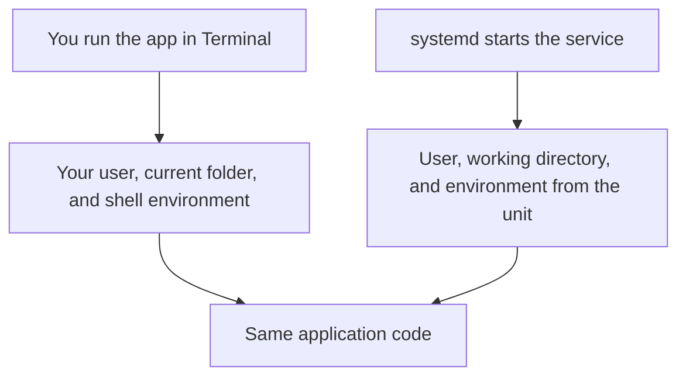

# Day 2 · Why does my app run in Terminal but fail as a service?

Tan, remember the end of Day 1? You stopped Python, tried the same URL again, and got a connection refusal. Today we’re looking behind that refusal. **Who starts the process? What does it have access to? Where do you look when it disappears?**

## Start with what actually runs

Say you open two Terminal tabs and run the same `worker.py` file in both. There’s one script on disk, but there are now **two processes**. Each has its own memory, its own open files, and its own **PID**, the number the operating system uses to identify it. Stop one and the other can keep going.

When you see a process in `ps`, a few columns tell you how to read it:

| Column | What you’re looking at |
|---|---|
| `PID` | The number of the process you’re investigating. |
| `PPID` | Its parent’s PID. In today’s lab, your shell starts the worker. |
| `USER` | The account the process runs as. This matters when it tries to read a config file or write a log. |
| `STAT` | What it’s doing at that moment. An `S` usually means it’s sleeping, which is ordinary for a worker waiting for work. |

A process also has a **working directory**. If your code opens `config.yaml`, where does Python look? Imagine you ran `pwd` just before starting it. That directory is where the relative path begins. So you can run the exact same Python executable and script from two folders and get two different results.

### Why you can read a file and the app can’t

Imagine you log in as `tan` and successfully read the config. The service runs as `orders`. Your successful read tells you that **your account** has access. The service still needs permission under its own account.

If you see `-rw-r-----` on a file, read the permissions in three groups. `rw-` gives the owner read and write access. `r--` lets the group read it. `---` gives everyone else no access. Now imagine the file itself allows the service to read it, but it sits under `/home/tan`, a directory only you can enter. The service can still get `Permission denied`. For a directory, **`x` lets a process traverse it** on the way to a file. Check the directories along the path as well as the file itself. [Linux path permissions](https://man7.org/linux/man-pages/man7/path_resolution.7.html)

## What `systemd` does when you start a service

When you type a command, **your shell** launches it. On many Linux servers, **`systemd`** launches long-running services. It reads a **unit**, a file that describes the command, the account to run it as, the starting directory, and what to do if it exits.



Here’s the bit that catches people. You might have run `cd /opt/orders/current`, activated a Python virtual environment, and exported a variable before testing. When `systemd` starts the app, it starts from the unit’s settings. An absolute Python path in `ExecStart=` makes the interpreter choice explicit. `WorkingDirectory=` tells it where to start. `User=` tells it whose permissions to use. [How systemd sets up a process](https://www.freedesktop.org/software/systemd/man/latest/systemd.exec.html)

When things break, I’d look at three things in this order: **what state the service is in, what it was told to run, and what it logged**. These are commands for a Linux host that runs `systemd`:

```bash
systemctl status orders-api.service
systemctl cat orders-api.service
journalctl -u orders-api.service -b -n 50 --no-pager
```

`status` tells you what the manager sees. `cat` shows the unit definition and any drop-in overrides. `journalctl` shows the last 50 entries for this service from the current boot. I’d look for the **first specific error**. A line like `Start request repeated too quickly` can come after several failed starts. The earlier line might tell you the file it couldn’t open. [systemctl](https://www.freedesktop.org/software/systemd/man/latest/systemctl.html) · [journalctl](https://www.freedesktop.org/software/systemd/man/latest/journalctl.html)

## Open files and signals · What a process is holding, and how it stops

When a process opens a log file, the operating system gives it a small number it can use to access that file. The number is a **file descriptor**, or **FD**. Network sockets use descriptors too. That’s why an API with thousands of open connections can hit an error that says `Too many open files`.

Three numbers you’ll see often are `0` for input, `1` for normal output, and `2` for error output. When you run Python from Terminal, its output usually goes to your screen. In the lab, we’ll point `1` and `2` at a log file. A `systemd` service commonly has those streams routed to the journal. Same Python `print()`, different destination. [Linux file descriptors](https://man7.org/linux/man-pages/man5/proc_pid_fd.5.html) · [systemd output settings](https://www.freedesktop.org/software/systemd/man/latest/systemd.exec.html#StandardOutput=)

Now imagine deploying a new version while the old worker is halfway through an order. **`SIGTERM`** asks the old process to terminate. If the app handles that signal, it can stop taking work and finish or safely hand off what it has. **`SIGKILL`** forces termination. The app can’t catch that signal and run its shutdown code. By default, `systemd` starts with `SIGTERM` and can escalate when the configured wait expires. [systemd shutdown signals](https://www.freedesktop.org/software/systemd/man/latest/systemd.kill.html)

## Interview questions · Work through the clue

### 1. `systemctl` says `active (running)`. Why might customers still be unable to use the API?

The service manager sees a running process. Think back to Day 1. Is that process listening on the expected address and port? Can a request actually get through it? An app could be alive but stuck waiting for a database, or listening on `127.0.0.1` when the load balancer needs to reach it on a private interface. On Linux, `ss -ltnp` helps you check the listener. Then test the real endpoint from the path that’s failing.

### 2. What does `203/EXEC` tell you?

This clue comes from `systemd` trying to launch the executable in `ExecStart=`. Start by checking the exact path, whether the executable is there, and whether the service account can reach and execute it. A Python `FileNotFoundError` gives you a different starting point. If Python printed that traceback, it already ran. Now investigate the file the application tried to open. [systemd exit status codes](https://www.freedesktop.org/software/systemd/man/latest/systemd.exec.html#Process%20Exit%20Codes)

### 3. You edited the unit file. Why did a restart still use the old settings?

Think of the file on disk and the settings the manager has loaded as two separate things. After changing a unit or its drop-in, `systemctl daemon-reload` tells `systemd` to reread those definitions. Then restart the service through the deployment process so it starts with the new settings. `systemctl reload orders-api.service` has a different job. It asks the running app to reload its own configuration, if the service supports that operation. [systemctl reload and daemon-reload](https://www.freedesktop.org/software/systemd/man/latest/systemctl.html)

### 4. Why could `ulimit -n` in your SSH session look fine while the service hits `Too many open files`?

You asked your **shell** about its limit. The failing worker was launched by a service manager and may have a different one. On Linux, check `Max open files` in `/proc/<PID>/limits` for the actual worker. Then inspect `/proc/<PID>/fd` or use `lsof -p <PID>` to see what it’s holding. The next question is whether those descriptors rise with traffic and come back down, or keep accumulating after work has finished. [Linux per-process limits](https://man7.org/linux/man-pages/man5/proc_pid_limits.5.html)

## Production scenarios · Same program, different launch conditions

### The orders API works from SSH and dies under `systemd`

Suppose a deployment goes out, and the API refuses a direct connection on the host. A teammate SSHs in, runs `cd /opt/orders/current`, starts the app, and it works. Meanwhile the service journal says:

```text
FileNotFoundError: [Errno 2] No such file or directory: 'config.yaml'
```

Look at the quotes around `config.yaml`. There’s no directory in that path. Your teammate had already entered the folder containing it. On this host, the system unit has no `WorkingDirectory=`, so the system service manager starts it from `/` by default. The app looks for `/config.yaml` and exits before it starts listening.

Once you’ve confirmed the file exists in `/opt/orders/current` and the `orders` account can access it, the relevant unit settings could look like this:

```ini
[Service]
User=orders
WorkingDirectory=/opt/orders/current
ExecStart=/opt/orders/current/.venv/bin/python /opt/orders/current/app.py
```

If the app supports an absolute config path, that’s another way to make the lookup explicit. After deploying the fix, watch the journal to see that startup completed, then hit `/health` and test the caller’s route. A healthy manual run was a useful clue. The service-managed process is the one you need to verify. [systemd working directory behavior](https://www.freedesktop.org/software/systemd/man/latest/systemd.exec.html#WorkingDirectory=)

### What really happened at Jane Street

Jane Street moved an internal job runner to `systemd` user services. On their hosts, the new launch path skipped an old limit override. The Kafka support processes’ **soft file-descriptor limit dropped from 262,144 to 32,768**.

During one network maintenance event, `lsof` showed UDP sockets piling up. When a socket couldn’t be bound, the code left it open. A later maintenance event caused a surge of TCP reconnects, and two processes hit their limit and crashed. The limit change made the workers run out of room sooner. The leak and reconnect surge explain why they needed so many descriptors in the first place. If you inherit an incident like this, check **both** the limit the process actually received and what’s consuming it. [Jane Street’s incident write-up](https://blog.janestreet.com/how-recurring-network-maintenance-exposed-6-bugs/)

## Mac lab · See a PID, open descriptors, and a clean shutdown

I verified this on your Mac. Use **one Terminal tab** throughout so `$worker_pid` and `wait` refer to the same worker.

### A. Start a worker that knows how to stop

```bash
lab_dir=$(mktemp -d)

cat > "$lab_dir/worker.py" <<'PY'
import os
import signal
import time
from pathlib import Path


def stop(_signal, _frame):
    raise SystemExit(0)


signal.signal(signal.SIGTERM, stop)
log_path = Path(__file__).with_name("worker.log")

with log_path.open("a", buffering=1) as log:
    log.write(f"started pid={os.getpid()}\n")
    try:
        while True:
            time.sleep(1)
    finally:
        log.write("clean shutdown\n")
PY

python3 "$lab_dir/worker.py" > "$lab_dir/console.log" 2>&1 &
worker_pid=$!
cat "$lab_dir/worker.log"
```

Read the Python in three pieces. It opens a log, waits in a loop, and writes `clean shutdown` when its `SIGTERM` handler exits the loop by raising `SystemExit`. The shell runs it in the background with `&`, and `$!` gives you the PID of that job. Wait until you see the `started pid=...` line before moving on. If you checked too early, run the `cat` command again. If it still doesn’t appear, look in `console.log` for a startup error.

### B. Look at what the worker is holding open

```bash
ps -p "$worker_pid" -o pid,ppid,user,stat,command
lsof -a -p "$worker_pid" "$lab_dir/console.log" "$lab_dir/worker.log"
```

`ps` shows the PID, parent, and user. The worker spends almost all its time sleeping, so an `S` in its state makes sense. In `lsof`, look for two entries pointing to `console.log`, typically `1w` and `2w`. Those are stdout and stderr. `2>&1` told the shell to send stderr to the same destination as stdout. You’ll also see a separate descriptor for `worker.log`, which Python opened itself. The `w` means it’s open for writing.

### C. Ask it to stop and check what it did

```bash
kill -TERM "$worker_pid"
wait "$worker_pid"
printf 'Exit status: %s\n' "$?"
cat "$lab_dir/worker.log"
```

You should see **exit status `0`** and **`clean shutdown`** in the log. That final line is your evidence that the process got a chance to run its shutdown code.

Clean up the temporary files:

```bash
rm "$lab_dir/worker.py" "$lab_dir/worker.log" "$lab_dir/console.log"
rmdir "$lab_dir"
```

**Your turn, Tan.** Send me the `lsof` lines and the final log. Then tell me how you’d explain this to a teammate: **“I can start the app from SSH. The service journal says it can’t find `config.yaml`. What would you check first, and why?”** We’ll work through your reasoning and publish the agreed Day 2 lesson in this same voice.