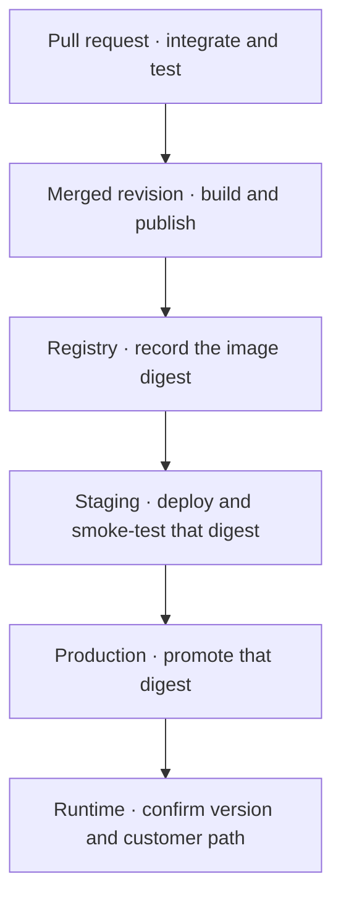

# Day 29 · Follow one commit from PR to production

Tan, suppose you change the orders API so customers can cancel an order. Your pull request goes green. A few hours later, support says the button still fails in production. Before you touch Jenkins, GitHub Actions, or Kubernetes, ask one question. **Which version did we test, and which version is actually answering customers?**

That question will make CI/CD easier to understand. We’ll follow the cancellation change all the way through, then work through what happens when the evidence stops lining up.

## Start at the pull request

Picture two developers changing the same service. Your change adds a cancellation endpoint. Someone else changes how order status is validated. Each change passes on a laptop. What happens once they’re together?

**Continuous integration**, or CI, is the habit of integrating small changes frequently and getting quick feedback on the combined code. The pipeline is how you automate that feedback. When your pull request runs, it might lint the code, run unit tests, and check whether a cancellation still works against a test database. Branch rules can require checks before merge. Where a team uses a merge queue, it can also validate changes against the proposed merge state.

A green check tells you what that run checked. A unit test might prove that paid orders can be cancelled. It can’t tell you whether production is running this commit or whether its database has the expected schema. Keep asking what each check actually exercised. [Google SRE on release engineering](https://sre.google/sre-book/release-engineering/)

## What actually leaves the build?

Once you have a version to ship, the build turns the source into an **artifact**. It might be a JAR, a compressed bundle, or a container image.

For the orders API, imagine CI builds a Docker image. The **Dockerfile** is the set of instructions. The **image** is the result. A **container** is an instance of that image started with runtime settings. In a multi-stage build, one stage can compile the service and the final stage can copy in the compiled output and supply the runtime. This lets you leave compilers and test tools out of the final image. The image goes to a **registry**, such as Amazon ECR, so staging and production can fetch it. [Docker on multi-stage builds](https://docs.docker.com/build/building/multi-stage/)

Now think of two ways to refer to that image:

- `orders-api:release-42` is a human-readable **tag**. A registry can allow the tag to move to another image. Some teams enforce immutable tags so an existing one can’t be moved.
- `orders-api@sha256:…` pins a **digest**, a content-based identifier for the image manifest or image index. That’s the identifier you can record in the release and verify later. With multi-platform images, compare the same kind of digest when you trace a release. A published index digest and the platform manifest chosen by a runtime can legitimately differ. [Docker on image digests](https://docs.docker.com/dhi/explore/security-concepts/digests/)

The **commit SHA** identifies the source revision. The **image digest** identifies what was built from it. They answer different questions. Build the same commit again with a newer base image or different dependency resolution, and you may get different bytes. That’s why teams keep a record linking the commit, build run, image digest, and deployment.

## Build it once and promote that version

Say CI publishes digest `A`, and staging uses it. The team runs a smoke test that creates and cancels a test order. Now you know something useful about digest `A`. When the production change is ready, promote **that digest**. Production can still have its own credentials, endpoints, and configuration. If production is built separately, you need evidence for what that second build produced.



**Continuous delivery** keeps changes in a state where they can be deployed safely on demand. A person might still approve the production step. **Continuous deployment** sends every qualifying change to production automatically after it clears the gates. If an interviewer says “CD,” ask how their production promotion works. A scheduled release window and a fully automatic rollout call for different controls.

On a GitOps team, the promotion step could be a PR that changes the desired production digest in a deployment repository. Argo CD pulls and reconciles that desired state. The CI job can be finished while the runtime still shows an old version, so verify the reconciled release and the request path the customer uses. [OpenGitOps principles](https://opengitops.dev/)

## Which checks would actually catch a bad release?

Use the cancellation feature to see why you want different layers of evidence.

| Check | What you’d learn |
| --- | --- |
| Unit test | The cancellation rule behaves as expected for a known input. |
| Integration test | The handler can persist the cancellation with the database setup under test. |
| Test the packaged image | The runtime image contains what the service needs and actually starts. |
| Smoke test after deployment | A small, important request works against the environment you just deployed to. |
| Rollout signals | Error rate, latency, and business results stay within agreed bounds as traffic shifts. |

For an interview, pick a concrete failure and work backwards. If the image starts but can’t talk to the database in production, which of your checks would see it? If all you ran was a liveness endpoint that returns a constant `200`, you may need a safe synthetic transaction against the actual customer path. The release management guide takes that idea further with canary decision thresholds.

## Scenario · The staging build passed and production is broken

The staging run shows cancellation working. Production reports a failure after a release. The team says both used `orders-api:release-42`. Here’s the evidence you ask for:

| Place | Release record |
| --- | --- |
| Staging smoke run at 14:05 | Tested digest `A` |
| Registry promotion record at 14:18 | `release-42` was moved to digest `B` |
| Running production revision at 14:20 | Serving digest `B` |

The tag was the same in the two reports, so it looked like the same release. The digests show which bytes each environment actually used. You can say with confidence that the staging result for `A` didn’t test what production received. You still need logs and a request trace to establish what broke in `B`.

Start by holding any further promotion. Check whether a known-good digest is safe to restore given current database and configuration changes. Restore it through the normal release path when it’s safe, then check the running version and the cancellation request itself. To prevent a repeat, record the digest at build time and promote that record through the approval and deployment steps. Looking up a tag in the registry *after* the incident only tells you where it points now.

### Follow-up · What if both environments did use the same digest?

Now a rebuild gives you very little information. Compare what the process actually received in each environment. Is production pointing to a different database? Does its service role have permission? Is a feature flag on there? Was the schema expanded in staging but never applied in production? Pick the next check based on the failing request. A timeout sends you toward reachability and dependencies. A database error naming a missing column gives you something much more specific to verify.

### Follow-up · What does a release record need to answer?

Imagine you’re on call at 2 a.m. and someone asks which change to restore. You want to identify the image that was deployed, the commit and build that produced it, the configuration applied with it, when and where it went live, what verified it, and the last known-good version. A digest proves which artifact you selected. Test evidence, provenance, and authorization each answer their own questions.

## Five-minute Mac lab · Catch an accidental rebuild

We’ll use compressed bundles as stand-ins for images. Open Terminal and run this from any folder.

```bash
lab_dir=$(mktemp -d)
mkdir "$lab_dir/build" "$lab_dir/staging" "$lab_dir/prod"

printf 'Orders API version 42\n' > "$lab_dir/build/version.txt"
tar -czf "$lab_dir/build/orders-api.tgz" -C "$lab_dir/build" version.txt

cp "$lab_dir/build/orders-api.tgz" "$lab_dir/staging/orders-api.tgz"
cp "$lab_dir/build/orders-api.tgz" "$lab_dir/prod/orders-api.tgz"

shasum -a 256 "$lab_dir/staging/orders-api.tgz" "$lab_dir/prod/orders-api.tgz"
```

Compare the long numbers in the first column. They match because you copied the same bytes. Now simulate somebody rebuilding before production and keeping the filename.

```bash
printf 'Orders API version 43\n' > "$lab_dir/build/version.txt"
tar -czf "$lab_dir/prod/orders-api.tgz" -C "$lab_dir/build" version.txt
shasum -a 256 "$lab_dir/staging/orders-api.tgz" "$lab_dir/prod/orders-api.tgz"
```

The path still ends in `orders-api.tgz`, and now the two hashes differ. If someone asked whether staging tested the production artifact, point at that difference and explain what you’d check next. In the real pipeline you’d use the registry’s image digest, captured at publication and verified at deployment.

Clean up the files you created.

```bash
rm "$lab_dir/build/version.txt" "$lab_dir/build/orders-api.tgz"
rm "$lab_dir/staging/orders-api.tgz" "$lab_dir/prod/orders-api.tgz"
rmdir "$lab_dir/build" "$lab_dir/staging" "$lab_dir/prod" "$lab_dir"
```

**Put it into your own words.** You’re given a green PR, a passed staging smoke test, and a red production dashboard. Explain what each tells you, then name the first piece of evidence you’d ask for. Try answering before you look back at the scenario.

[Day 30 · Jenkins and Groovy](day-30-jenkins-pipelines.md) · [Day 31 · GitHub Actions](day-31-github-actions.md) · [Day 33 · Release management](day-33-release-management.md)
