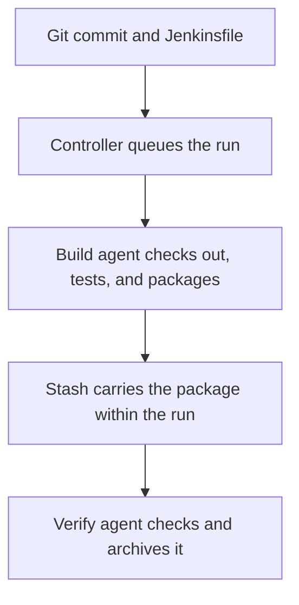

# Day 30 · How Jenkins runs a pipeline

Tan, someone says, “Jenkins failed.” Before opening the application code, ask what the run actually managed to do. Did it get a worker? Did it check out the commit? Did it run tests? Could the next stage find the package? Those questions give you different places to look. We’ll follow one small order service through Jenkins so you can explain those choices in an interview.

## Who does the work?

The **controller** manages jobs, queues work, coordinates the pipeline, and records the result. An **agent** connects to the controller and runs work on a machine or in a container. An **executor** is a slot on that node that can run a task. A **label** tells Jenkins which nodes fit the job. For example, `python-linux` might mean a Linux agent with Python already installed.

On the agent, Jenkins checks the code out into a **workspace**. That’s a directory, and the shell commands in that stage normally run there. If the next stage gets a different agent, it may be looking at a different filesystem. Even identical paths such as `/var/jenkins/workspace/orders` can point to different files on two machines. [Jenkins guide to nodes and executors](https://www.jenkins.io/doc/book/managing/nodes/)



The controller coordinates the run. Each agent has its own workspace, so the artifact needs an explicit handoff.

## Read a Jenkinsfile like you’d read a plan

The `Jenkinsfile` lives with the service in Git. You can review a pipeline change in the same pull request as the code change and trace which version of the pipeline was used for a run. Jenkins calls this **pipeline as code**. A **Multibranch Pipeline** can discover branches with a `Jenkinsfile`. `checkout scm` fetches the revision the branch or pull request job is set up to build. That matters when the job tests a proposed merge rather than the branch head alone. [Jenkinsfile guide](https://www.jenkins.io/doc/book/pipeline/jenkinsfile/) · [Multibranch Pipeline](https://www.jenkins.io/doc/book/pipeline/multibranch/)

Read the example from the outside in. `pipeline` is the Declarative Pipeline written in Groovy syntax. `stage` names an outcome you can see in the run. `steps` are the specific actions. The top-level `agent none` leaves worker allocation to each stage. The `when` condition runs the archive stage only for `main`. `beforeAgent true` checks that condition before reserving a worker. `post` runs actions based on the result, so you have a place for failure messages or publishing test reports. [Declarative Pipeline syntax](https://www.jenkins.io/doc/book/pipeline/syntax/)

This example expects a Multibranch Pipeline for a small Python service with an `app/` directory and at least one real `unittest` test in `tests/`. Configure `python-linux` and `verify-linux` as labels on suitable Linux agents, or replace the labels with ones your Jenkins uses. The first needs Git, Python 3, `tar`, and `sha256sum`. The second needs `tar` and `sha256sum`. Both `deleteDir()` calls clear the current Jenkins workspace before putting files in it. Read the example here or copy it into an isolated practice repository as `Jenkinsfile`.

```groovy
pipeline {
    agent none
    options { skipDefaultCheckout() }

    stages {
        stage('Test and package') {
            agent { label 'python-linux' }
            steps {
                deleteDir()
                checkout scm
                sh '''
                    set -eu
                    python3 -m unittest discover -s tests -v
                    mkdir -p dist
                    tar -czf dist/orders-app.tgz app/
                    sha256sum dist/orders-app.tgz > dist/orders-app.tgz.sha256
                '''
                stash name: 'candidate', includes: 'dist/orders-app.tgz,dist/orders-app.tgz.sha256'
            }
        }

        stage('Verify and archive main candidate') {
            when {
                beforeAgent true
                branch 'main'
            }
            agent { label 'verify-linux' }
            steps {
                deleteDir()
                unstash 'candidate'
                sh '''
                    set -eu
                    sha256sum -c dist/orders-app.tgz.sha256
                    tar -tzf dist/orders-app.tgz
                '''
                archiveArtifacts artifacts: 'dist/orders-app.tgz,dist/orders-app.tgz.sha256', fingerprint: true
            }
        }
    }

    post {
        failure {
            echo 'Inspect the first failed stage and its log.'
        }
    }
}
```

Follow the bytes. Tests run first, the package gets built once, and the verification stage receives that package and checks its SHA-256. `stash` and `unstash` handle small transfers within a run. `archiveArtifacts` keeps the files with that Jenkins build while its records are retained. For a real container release, you’d generally publish the image to a registry and promote the recorded image digest. The `main` condition keeps the exercise focused. Production access also depends on the job’s trust settings, agent access, and credential policies. [Jenkins stash and unstash](https://www.jenkins.io/doc/pipeline/steps/workflow-basic-steps/#stash-stash-some-files-to-be-used-later-in-the-build) · [Jenkins artifact archiving](https://www.jenkins.io/doc/pipeline/steps/core/#archiveartifacts-archive-the-artifacts)

## Where credentials and shared code belong

At work, a publish step may need registry credentials. Jenkins lets you refer to a stored credential by ID and bind it for the step that needs it. Keep that scope narrow, give the identity only the registry permissions it needs, and reserve release credentials for trusted jobs. If a shell command needs a secret, let the shell expand the variable from its environment by using a single-quoted Groovy `sh` string. Keep secrets out of command output. Masking log output is one layer. Other processes on a shared agent may be able to see environment variables, so agent isolation matters too. [Jenkins Credentials Binding](https://www.jenkins.io/doc/pipeline/steps/credentials-binding/)

If several services all package and publish in the same way, a **Shared Library** can hold that common step. The individual `Jenkinsfile` still shows where the team tests, publishes, and stops for approval. Pin a reviewed library version and try a change with one service first. A library update can affect many pipelines, and a globally trusted library can run privileged Jenkins code, so review access to its repository as carefully as the library code. [Jenkins Shared Libraries](https://www.jenkins.io/doc/book/pipeline/shared-libraries/)

## Work through two interview incidents

### The build passed, but the package vanished

The package log shows `dist/orders-app.tgz` on `linux-build-07`. The next stage runs on `linux-verify-02` and gets `No such file or directory`. Check the node name and workspace in each stage and look for a transfer step. If the stage boundary explains the failure, restore the handoff with `stash` and `unstash` for this small package, or use a registry or artifact store for a release that another job will consume. Verify on a fresh downstream workspace and match the digest to the build output. Rebuilding on the second worker would leave you having to prove what bytes were actually promoted.

### The release job has been waiting for 20 minutes

The console says `Still waiting to schedule task` and the stage requires `verify-linux`. Find the queue reason, then check which agents have that label, whether they’re online, and whether their executors are busy. If there are idle agents with a different label, first confirm whether they have the required tools and access. If the eligible pool is full, restore capacity there or fix provisioning. Check that this run actually started on an eligible node and that later runs spend less time in the queue. Queue time and shell execution time tell you different things. [Jenkins node management](https://www.jenkins.io/doc/book/managing/nodes/)

## Your first 90 seconds

Say the UI shows `Test and package` green and `Verify and archive main candidate` red. The log contains `No such saved stash 'candidate'`. Before proposing a fix, name three things you’d check. Which run produced the stash? Did the producer reach that step? Did both steps use the same stash name? Explain what would change your answer if verification ran as a separate job, then say what evidence you’d want before approving promotion.
