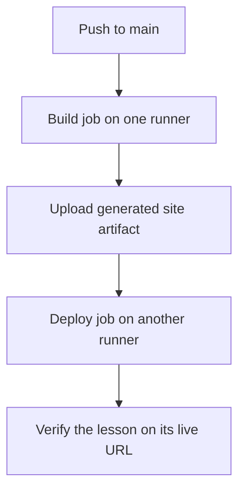

# Day 31 · GitHub Actions from pull request to live site

Tan, this study site gives us a deployment you can actually follow. When a lesson reaches `main`, GitHub Actions turns the Markdown into a site, saves the built files, and hands those files to a deployment job. If the new lesson is missing from the live site, each of those steps gives you a place to look.

## Read the workflow in the order it runs

Start with `on:`. It answers **what happened in GitHub that started this run?** A `pull_request` workflow is useful for checking proposed changes. A `push` to `main` sees the code after merge. `workflow_dispatch` lets someone with access start a run manually. If no run appears, check the event and branch or path filters before looking for a broken test.

Inside the workflow are **jobs**. A job gets a **runner**, the machine that executes it. Inside the job are **steps**. A `run:` step executes a command, and a `uses:` step calls an action. Steps in a job can read files written by earlier steps in that job. A separate job on a standard GitHub-hosted Ubuntu runner gets a fresh machine. A self-hosted runner can reach private networks or use specialized hardware. Your team then owns its health, security, and cleanup, which matters when deciding what code it can run. [Workflow syntax](https://docs.github.com/en/actions/reference/workflows-and-actions/workflow-syntax) · [GitHub-hosted runners](https://docs.github.com/en/actions/concepts/runners/github-hosted-runners)



Follow the arrows from top to bottom. The built files reach the second job through the uploaded artifact. The last check happens against the site a reader actually uses.

## A small workflow you can read end to end

Imagine a Python service repo with standard-library tests in `tests/test_*.py`. This example belongs in that repo's `.github/workflows/ci.yml`. Read it once just for the event, machine, and commands.

```yaml
name: Python checks

on:
  pull_request:
    branches: [main]
  push:
    branches: [main]

permissions:
  contents: read

jobs:
  test:
    runs-on: ubuntu-latest
    timeout-minutes: 10
    steps:
      - name: Check out the revision
        uses: actions/checkout@3d3c42e5aac5ba805825da76410c181273ba90b1 # v7.0.1
        with:
          persist-credentials: false
      - name: Set up Python
        uses: actions/setup-python@6d4fd22b20465ccc0f7354476588e8df7c9ca0e0 # v7.1.0
        with:
          python-version: '3.12'
      - name: Run unit tests
        run: python -m unittest discover -s tests
```

If a developer opens a PR to `main`, GitHub runs the checks. If the change is merged, the push runs them on the resulting revision. Python is selected explicitly so the tests can behave consistently across runner image updates. In a team repo, a branch rule can require the test check before merging. That rule is what makes the test result a gate. A test job by itself reports a result. [GitHub workflow triggers](https://docs.github.com/en/actions/reference/workflows-and-actions/events-that-trigger-workflows) · [Protected branches](https://docs.github.com/en/repositories/configuring-branches-and-merges-in-your-repository/managing-protected-branches/about-protected-branches)

### Interview scenario · The build passed. Where did my file go?

You add a deployment job with `needs: build`. It starts and fails with `No such file or directory: dist/service.tar.gz`. The build log clearly shows the file being created.

Ask **which machine saw that path?** `needs` waits for the build job's result. The deploy runner starts with its own filesystem. Upload the build output as an **artifact**, then download that named artifact from the same run in the deploy job. Look at the upload step to confirm it matched files, then check the download path and the artifact's commit or digest before deploying.

A **cache** is for reusable inputs such as package downloads. A cache miss should cost time and leave the job able to fetch those inputs again. An artifact is the specific output or evidence you want to retain for this run. If an artifact is missing, stop and find out which build produced the candidate. [Workflow artifacts and caching](https://docs.github.com/en/actions/concepts/workflows-and-actions/workflow-artifacts)

## See the same handoff in our study repo

Open the [real Pages workflow](https://github.com/Tech-Sayantan/senior-devops-interview-prep/blob/main/.github/workflows/pages.yml). Find these three parts:

- `build` checks out the repo, runs the Python site builder, and uploads `_site` with the Pages artifact action.
- `deploy` has `needs: build`. It uses the Pages deployment action to publish the artifact. This job gets `pages: write` and `id-token: write` for Pages deployment. The build job has read permissions.
- The workflow uses the `github-pages` environment and a shared concurrency group so Pages deployments from this workflow run one at a time.

For **verification**, start with the run's commit and find the uploaded artifact in that run. Then check the deploy job and its reported URL. Finally open the specific lesson URL and look for something introduced by that commit. A green build tells you the generator produced output. The live check tells you whether the intended output reached the reader. [GitHub Pages build and deploy handoff](https://docs.github.com/en/pages/getting-started-with-github-pages/using-custom-workflows-with-github-pages)

## Control who can deploy, and what happens when two runs collide

A GitHub **environment** is a named deployment target in settings. Depending on the repository plan and visibility, you can restrict which branches can deploy and require a reviewer. The environment's rules must pass before the job runs or gets environment secrets. **Concurrency** controls overlapping jobs or runs that share a group. Think of a production environment whose gate checks permission to enter and whose concurrency group controls how many jobs can be inside at once. [Environments and protection rules](https://docs.github.com/en/actions/how-tos/deploy/configure-and-manage-deployments/manage-environments) · [Workflow concurrency](https://docs.github.com/en/actions/how-tos/write-workflows/choose-when-workflows-run/control-workflow-concurrency)

Imagine production is running version B. Someone reruns an older workflow for version A, and A deploys after B. The deploys can both succeed and run one at a time. Check the deploy run's commit and artifact digest against the intended version. For a pipeline that automatically ships the current `main` revision, add a freshness check just before deployment. Give an intentional rollback its own reviewed path and exact artifact selection. That way a rerun is less likely to look like an approved rollback.

Give each job the permissions it needs. Our example's checkout action is pinned to a full commit SHA, so the exact action code is reviewable even if a release tag moves. Review action updates and keep privileged jobs on trusted code paths. PRs from forks are an outside contribution. Run their proposed code with a restricted token and no deploy credentials. If you use `pull_request_target` for tasks like labeling, keep it in the trusted base context and avoid checking out and executing proposed code in that workflow. [GitHub Actions secure use](https://docs.github.com/en/actions/reference/security/secure-use)

## AWS OIDC · Who is this job, and what can it do?

Think of a signed identity document handed from GitHub to AWS. A trusted deploy job with `id-token: write` can ask GitHub for an OIDC token. AWS Security Token Service checks the token and the IAM role's **trust policy**. If the checks pass, AWS issues short-lived role credentials. The **role permissions**, together with other applicable AWS policies, determine what those credentials can do. You can scope the trust to the intended repository and protected production environment. Check the specific audience and subject format for that repo. GitHub's subject can include immutable owner and repo IDs, and the subject changes shape when a job uses an environment. [GitHub OIDC in AWS](https://docs.github.com/en/actions/how-tos/secure-your-work/security-harden-deployments/oidc-in-aws) · [AWS OIDC providers in IAM](https://docs.aws.amazon.com/IAM/latest/UserGuide/id_roles_providers_create_oidc.html)

**Interview scenario · Staging gets AWS credentials. Production fails at `AssumeRoleWithWebIdentity`.** First see whether the job was allowed to start and request its GitHub token. If AWS STS rejected the exchange, check the role ARN, issuer, audience, and the production subject against the trust conditions. For example, the job may have switched to a `production` environment while the role still expects a branch-based subject. If role assumption succeeds and a later AWS command is denied, check which identity actually ran that command and which AWS policy covers the action and resource. Read identity details and error messages with secrets and full tokens kept out of logs.

## Try one two-minute drill

In the [Actions history for this site](https://github.com/Tech-Sayantan/senior-devops-interview-prep/actions/workflows/pages.yml), pick a successful run. Find its commit, the step that uploads the site, and the step that deploys it. Then say what you would check if deploy succeeded but the new page still looked old. Your explanation should tell me **which revision you expected**, **what the deployment received**, and **what the live URL returned**.

[Continue to safe releases and rollback](day-33-release-management.md)
