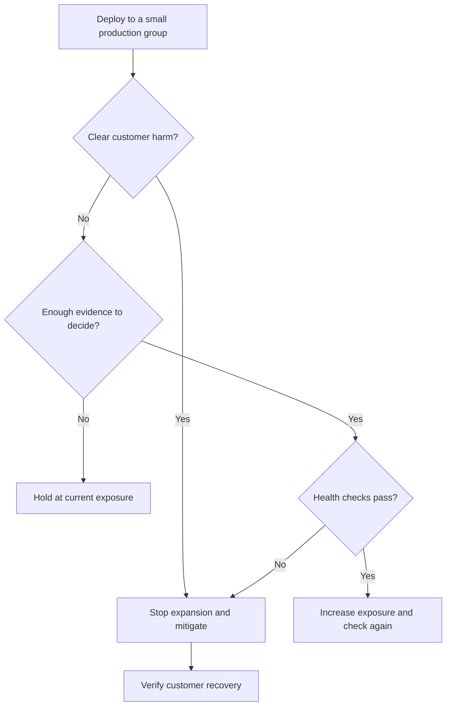

# Day 33 · A release is live. Should you send it more traffic?

Tan, imagine you’re on call for an orders API. The pipeline is green, the new containers are running, and someone asks you to finish the rollout. Then checkout errors start climbing on the new version. Do you wait, stop sending it traffic, or go straight back to the previous version? Let’s work through what you’d actually need to know to make that call.

## Deploying code and exposing a feature

Say version `v42` contains a new checkout screen. At 10:00, you **deploy** `v42` to production. The new screen stays hidden because its **feature flag** is off. At 11:00, you switch it on for employees. That’s the **release** to that group. At noon, you extend the release to 5% of customers.

If the new screen fails, switching off its flag might restore the checkout path while `v42` keeps running. That only helps when the flag actually controls the failing behavior. If `v42` crashes at startup or changes how every order is written, the flag may leave the problem in place. You can make this distinction in an interview by asking *what changed for users and what changed underneath them?*

## How much production traffic should see the change?

| Approach | What happens | What I’d check before choosing it |
| --- | --- | --- |
| **Rolling** | Replace old instances in batches as new ones become ready. Both versions may serve users during the update. | How much capacity can you take out at once? Can the two versions handle the same requests, messages, and database state? |
| **Canary** | Give a small share of users, requests, or instances the new version and compare the result with a group on the stable version. | Can you measure the two groups separately? Is the canary getting enough of the requests that exercise the change? |
| **Blue-green** | Keep a stable environment and a second environment for the new version. Validate the new one, then switch traffic to it. | Can you keep both environments warm? If they share a database, can the old version still use the data after the switch? |

These choices solve different problems and can be combined. A rolling update controls how instances are replaced. A canary controls how you evaluate the new version before widening exposure. With two environments, you might send 5% of traffic to green as a canary before you move the rest. [Kubernetes rolling updates](https://kubernetes.io/docs/concepts/workloads/controllers/deployment/#rolling-update-deployment) · [Google SRE on canarying releases](https://sre.google/workbook/canarying-releases/)

## What would make you stop a rollout?

Decide the checks before you start. Suppose you’re changing checkout. You want a smoke test that goes far enough to create a **test order** through a controlled test path. Check that the response and recorded order match what you expected. Then watch checkout error rate and **p95 latency** by revision. A p95 of 400 ms means about 95% of the measured requests finished within 400 ms. Comparing matching routes and regions over the same time window gives you a better clue than comparing the whole canary with a fleet-wide average.

Agree on three outcomes. **Promote** if you’ve seen enough traffic through the changed path and the checks pass. **Hold** if the result is unclear, traffic is too low, or metrics are missing. **Stop and mitigate** if the signals cross the agreed limits or you have evidence of something serious like wrong charges. On 20 requests, one error is already 5%, so you want both a minimum sample size and a decision for what happens if you never reach it. Set thresholds for the service and its normal behavior. [Google SRE on selecting and evaluating canary metrics](https://sre.google/workbook/canarying-releases/)

Here’s how to read that decision path. A quiet graph with too few checkout requests earns a hold. A clear customer-impact signal earns an immediate investigation and mitigation, even during a short window.

## What do you need to know about the version?

If the team says “we rolled back to `v41`,” I’d ask which build and config reached production. Record the commit, image digest, deployment time, environment, flag and config changes, and any database migration that ran. `v41` is an easy label to say aloud. The digest lets you identify the exact image, and the deployment record tells you what went with it. A reviewer can then ask whether the recovery path still works and who owns the stop decision. See [how a build becomes a release candidate](day-29-cicd-and-artifacts.md).

With Argo CD auto-sync, one common design is for CI to propose a version change in Git and for Argo CD to apply that desired state. If you decide to restore the previous compatible revision, revert the promotion in Git and verify the reconciled image, configuration, and customer path. A manual `kubectl` edit can be undone by self-heal while Git still points at the bad revision. A Git revert records the intended change and leaves a history of the promotion and recovery. [Argo CD automated sync and self-heal](https://argo-cd.readthedocs.io/en/stable/user-guide/auto_sync/)

## When going back can make things worse

Suppose `v41` reads `delivery_address` from your database. A migration in `v42` drops that column and replaces it with `shipping_address`. If you restore the old image now, it still asks for `delivery_address` and fails. A previous image is a useful recovery option only if it can work with the state production has today.

You can plan that change as **expand and contract**. First add `shipping_address` while preserving `delivery_address`. Roll out code that keeps the old representation usable and can populate the new one. While old writers still exist, keep the old field authoritative. Once every writer is compatible, backfill or reconcile the new field, verify it, and switch reads. Drop the old field in a later migration after the team has passed the rollback window and checked that every consumer has moved. Test the old and new versions together, then test putting the old version back after the new one has written data. [AWS Builders’ Library on rollback safety](https://aws.amazon.com/builders-library/ensuring-rollback-safety-during-deployments/)

If the destructive migration has already run, pause promotion and establish which versions can still read and write safely. A **roll-forward** could be a tested fix that works with the current schema or a tested compatibility change that restores a required field and its data. A database restore can affect orders accepted since the snapshot, so bring in the data owner before choosing it. Separate restoring service from cleaning up the incident afterward.

## Interview scenario · The overall dashboard looks fine

Here’s an illustrative evidence packet. `v42` is receiving 5% of checkout requests. You agreed to gather at least 300 canary checkout requests, then stop if the canary’s error rate is at or above 1% or its p95 latency is more than 200 ms slower than the stable group. The same ten-minute window in the same region shows:

| Version | Checkout requests | 5xx responses | Checkout p95 |
| --- | ---: | ---: | ---: |
| Stable `v41` | 7,600 | 19 | 240 ms |
| Canary `v42` | 400 | 16 | 690 ms |

The combined 5xx rate is about **0.44%**. The stable group is at **0.25%**. The canary is at **4%** and its p95 is **450 ms** slower. The sample meets your gate, and both stop conditions are met. That’s the evidence you can state out loud before picking a tool.

1. **Stop the expansion and check the impact.** Confirm requests to the changed route are the ones failing and capture the revision, window, and rollout state. Tell the on-call team you’re holding the release.
2. **Reduce exposure if the stable version can take the traffic and use today’s data.** If the migration only added a compatible field, a traffic switch back to stable may be quick. If `v41` needs a field that was dropped, check for a compatible recovery path with the data owner before increasing traffic to it. Keep looking for the narrowest mitigation that restores checkout.
3. **Verify recovery.** Check the routing and runtime revision, run a controlled checkout, and watch 5xx, p95, and successful orders through the affected path. Capture the log or trace that ties the regression to a change while the evidence is available.

Try it aloud with a twist. First give your answer with an additive migration. Then change one fact and assume the old column was dropped. What action does that change, and what evidence would you need to move forward? A seventy-second answer with a clear decision and verification step is enough for a first pass.

## What happened at Cloudflare in July 2019?

On July 2, 2019, Cloudflare shipped a web application firewall rule globally after its functional tests passed. The rule exhausted CPU and customers saw widespread `502` responses. Cloudflare temporarily disabled the affected component and traffic and CPU recovered. The team validated the rollback using limited traffic in one location before re-enabling the component globally. The postmortem called for staged rule rollouts and performance tests while retaining a way to do urgent global changes. [Cloudflare’s incident report](https://blog.cloudflare.com/details-of-the-cloudflare-outage-on-july-2-2019/)

Suppose that incident came up in your interview. Ask which signal would have stopped the release while the change was still in one location, and how the team could reach the stop control if the service itself was down. Passing CI told them something about the rules’ behavior in tests. A CPU check and a small production stage would have addressed a different risk.
